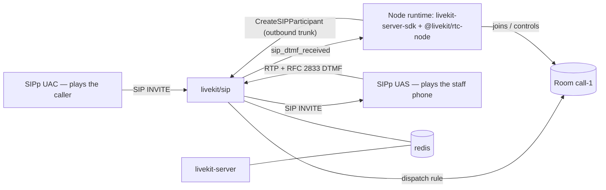

# Spike: screened transfer on LiveKit (Gate A, D-04)

**Question it answers:** can our runtime on LiveKit Agents prove that a human took a transferred call (INV-09: only
DTMF "1" during a whisper counts), and fall back cleanly otherwise — with real SIP signalling, before any phone
number or carrier exists?

**Run on 12 Nov 2026 with the owner's yes ("Approve both"): all seven cases pass — see `RESULTS.md`.** One change
from this plan: `MoveParticipant` is "not implemented" on self-hosted LiveKit, so screening happens in the caller's
room with the caller's track muted at the server. Everything stayed on this Mac: no LiveKit Cloud account, no phone
number, no carrier, no speech provider (the whisper is a tone).

## Topology

The runtime puts the staff leg in a separate screening room, plays the whisper there, waits for DTMF, and only
then joins staff and caller (by moving the staff participant into the caller's room; if the server version does
not allow that, by dialling staff into the caller's room with the caller's audio withheld until DTMF — the spike
records which works).

## Downloads (each to be approved)

| What | Source | Size | Why |
|---|---|---|---|
| Start the existing colima VM (0.10.3 installed) | already on this Mac | none; ~2 GB RAM while running | Docker engine |
| `livekit/livekit-server:v1.13` | Docker Hub | 39 MB compressed (arm64) | media server |
| `livekit/sip:v1.23` | Docker Hub | 61 MB compressed (arm64) | SIP ↔ room bridge |
| `redis:7.4-alpine` | Docker Hub | 17 MB compressed (arm64) | required by the SIP service |
| `sipp` 3.8.0 | Homebrew | small bottle | scripted caller and staff phone with DTMF |
| `livekit-server-sdk` 2.19.3, `@livekit/rtc-node` 1.2.2 | npm | 0.86 MB + 0.95 MB (+ native library) | the runtime side |

API key and secret are generated locally for the dev server; nothing is registered anywhere.

## Cases and pass rules

| Case | Staff phone (SIPp UAS scenario) | Pass if |
|---|---|---|
| S1 human accepts | answers, waits for the whisper, sends DTMF 1 | outcome `bridged`; caller and staff in one room; time from answer to bridge recorded |
| S2 voicemail | answers, plays audio, never sends DTMF | outcome `returning` after 10 s screening timeout; caller never hears "connected" |
| S3 declines | answers, sends DTMF 2 | outcome `returning` (declined) |
| S4 no answer | rings (180) and never answers | outcome `returning` after 20 s |
| S5 busy | 486 Busy Here | outcome `returning` at once |
| S6 caller hangs up during screening | UAC sends BYE while UAS is in the whisper | staff leg torn down; outcome `abandoned_during_transfer` |

Each case writes the same `handoffs`/audit evidence the Gate A gateway writes today (`request_human_transfer`), so the
spike plugs into SM-9 unchanged.

## Afterwards

`docker compose down`, `colima stop`; the images can be removed with `docker image rm`. Results and timings go in
`RESULTS.md` beside this plan, and into the blueprint's Gate A section.
