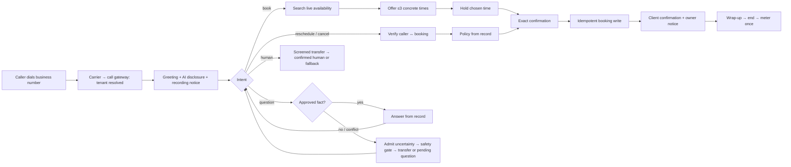
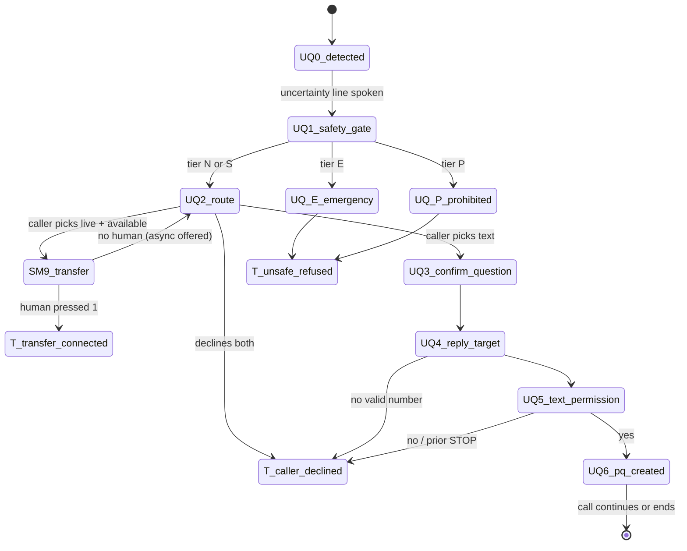

## 5. Journey maps and state machines

Every machine below is a design recommendation [REC]. States are typed; an event not listed for a state is
rejected with `VALIDATION_FAILED` and audited, never silently accepted. Times are defaults that each tenant may
tighten but not loosen beyond the stated bounds.

**Defaults for every machine** (a cell that says "default" means this):

- *Audit record (default)*: one `audit_events` row per transition — `tenant_id, machine, entity_id, from_state,
  to_state, event, actor (system | ai_runtime | owner:<id> | staff:<id> | caller | provider:<name>),
  policy_version, config_version, correlation_id (conversation or job), at`. Payloads are referenced, not copied.
- *Retry (default)*: none inside the state; external calls are retried only where the row says so.
- *Human intervention (default)*: the entity appears in the staff "Needs attention" queue with its last error.
- *Failure state (default)*: `failed` with a typed error; failures are never reported to a caller as success.

### 5.0 The journey in one picture

*Plain language:* the call is always one loop — understand, look up the real record, offer, confirm, write once,
tell both sides. Questions without an approved answer leave the loop through the unknown-question branch and the
call goes back to the loop or ends; nobody waits on hold for the owner.

### SM-1 Merchant onboarding and activation

| State | Entry condition | Permitted events | Validation | Side effects | Timeout | Retry | Failure state | Human intervention | Audit record |
|---|---|---|---|---|---|---|---|---|---|
| `lead` | Sign-up form submitted | `otp_sent` | Phone is E.164, country in launch list, rate limit 3 OTP/h/number, 10/h/IP | OTP via SMS (or LINE login in TH) | 15 min OTP life | resend ×2 | `abandoned` (30 d) | none | default + OTP send id (never the code) |
| `identity_verified` | OTP correct (≤5 tries) | `eligibility_submitted` | OTP hash compare, constant time; lockout after 5 | Create `users`, `organizations` (status `pending`) | 14 d | — | `abandoned` | none | default |
| `eligibility_review` | Category, country, operator age, services submitted | `eligible`, `ineligible`, `needs_review` | Category ∈ allowed list for launch vertical; excluded: HIPAA-covered/medical, physical therapy, medically operated spas, mainly-under-13 services, any category in the prohibited list (§12) | Borderline → O2 review task | 5 business days for review | — | `ineligible` (terminal, reason code) | O2 reviewer decides `needs_review` | default + category answers snapshot |
| `terms_pending` | Eligible | `terms_accepted` | Each document id+version accepted separately: service terms, DPA, AI-disclosure duty, recording, messaging, billing | Store acceptance rows (user, version, IP hash, at) | 14 d | — | `abandoned` | none | default + document versions |
| `configuring` | Terms accepted | `config_saved`, `config_published` | Location IANA tz set; ≥1 service with exact duration; hours; ≥1 escalation contact verified; every knowledge article has audience + effective date | Draft `configuration_versions` row | none | — | — | O2 can assist (assisted onboarding) | default + diff of config draft |
| `schedule_connecting` | Config draft exists | `ledger_selected`, `connector_authorized`, `sync_completed`, `mapping_conflict` | OAuth scopes ⊆ least-privilege list (§12 TH-09); initial sync totals reconcile | Initial import of busy time / bookings; mapping table | 1 h per sync attempt | sync ×3 (backoff 1/5/15 min) | `schedule_error` | Operator resolves ambiguous mappings (two staff named "Nok") | default + counts imported |
| `channels_connecting` | Schedule ready | `number_ready`, `owner_channel_verified`, `sender_registered`, `registration_pending` | Owner channel proven by challenge (LINE link token / SMS code); US: 10DLC brand+campaign approved before any SMS to callers | Provision/port number or give forwarding steps; enrol owner channel | US registration: up to provider SLA (D-10) | poll status hourly | `channel_blocked` | O2 support for rejected registrations | default + registration ids |
| `simulating` | Channels ready | `suite_passed`, `suite_failed` | All Gate-A scenarios for enabled intents pass on this tenant's config (§17) | Run synthetic calls against config | 24 h | rerun on config change | `suite_failed` (blocks go-live) | Fix config | default + suite run id, pass/fail per scenario |
| `review` | Suite passed | `approved`, `changes_requested` | O2 human reviewer signs (Gate C) | Publish config version N | 3 business days | — | `changes_requested` → `configuring` | Required (Gate C/D) | default + reviewer id |
| `live` | Approved and `config_published` | `pause`, `unpaid`, `incident`, `offboard`, `config_published` | Published config immutable; new versions only by publish | Routing on; metering on | none | — | — | none | default |
| `paused` | Owner pause, unpaid >N days, incident | `resume`, `offboard` | Unpaid resume needs payment success | Calls forward to business number or fallback voicemail; **never** answered by AI while paused | 90 d → `offboarding` | — | — | Support | default + reason |
| `offboarding` | Owner cancels or 90 d paused | `export_done`, `closed` | — | Offer data export; release or port number per D-11; stop routing | 30 d | — | — | Support | default |
| `closed` | Offboarding complete | `retention_expired` | — | Retention clock starts per class (§8) | per class | — | — | — | default |

**Activation moment** (metered for product analytics, not billing): the first real (non-test) booking created
by the AI that appears in the authoritative calendar and whose owner notice was delivered.

### SM-2 Inbound call lifecycle

| State | Entry condition | Permitted events | Validation | Side effects | Timeout | Retry | Failure state | Human intervention | Audit record |
|---|---|---|---|---|---|---|---|---|---|
| `ringing` | Carrier webhook `call.initiated` (signature valid, not a replay) | `tenant_resolved`, `tenant_unknown` | Webhook signature + timestamp ±300 s + dedupe on provider call id | Create `conversations` (channel=voice, status=`ringing`) | carrier deadline (~10 s to answer) | — | `unrouted` | none | default + provider call id, ANI hash, STIR/SHAKEN verstat (US) |
| `unrouted` (terminal) | Dialled number not mapped / tenant not `live` | — | — | Play fixed recorded message, or forward to tenant's fallback number if known | — | — | — | Incident if number belongs to a tenant | default; **not billable** |
| `config_loading` | Tenant resolved | `config_ready`, `config_timeout` | Published config exists | Pin `config_version` on the conversation; mint call capability token (§6.3) | 1,500 ms | read replica → cached last-known-good | `degraded_answer` | none | default + config version |
| `greeting` | Config ready | `greeting_done`, `caller_hangup`, `caller_objects_recording` | — | Speak disclosure [CODE] (§10.1); start recording only if tenant+jurisdiction policy allows and notice was played | 10 s | — | — | — | default + disclosure template id, recording on/off, offset ms |
| `in_dialogue` | Greeting done | `intent(book/reschedule/cancel/faq/human/other)`, `sub_machine_done`, `caller_silence`, `caller_hangup`, `provider_degraded`, `turn_limit` | Each tool call through Tool Gateway (§9) | Runs SM-3…SM-9 as sub-machines; one active consequential sub-machine at a time | Silence: reprompt at 6 s, again at 12 s, end at 20 s | — | `degraded` | Transfer available per SM-9 | turns, tool calls, intents (by reference) |
| `degraded` | STT/LLM/TTS/tool latency over budget twice in a row, or provider error | `recovered`, `fallback_done` | — | Speak bounded recovery line [CODE] ("I'm having trouble on my side.") then: transfer if available, else offer to take a message (pending question path), else give business contact [RECORD] and end | 30 s in state | provider failover once (§13) | `ended` with outcome `system_fault` | Incident page to O2 on-call | default + latency samples |
| `transferring` | SM-9 started | `bridged`, `transfer_failed` | — | AI paused; see SM-9 | SM-9 | — | back to `in_dialogue` | — | default |
| `wrap_up` | Caller says done, or AI completed all tasks | `caller_adds_task`, `ended` | Every pending consequential action is either committed, released or reported | Restate what was done ("You're booked for…") from records [RECORD] | 20 s | — | — | — | default |
| `ended` | Hangup either side, transfer bridged and AI left, or max duration | `post_processing_started` | — | Release open holds; stop recording | Max call length 15 min [REC], warning at 13 min | — | — | — | default + duration, ended_by |
| `post_processing` | Ended | `done` | — | Final transcript ref, outcome per intent, notifications from outbox, **metering decision** (SM-14) | 10 min | job ×5 | `post_processing_failed` | Data-ops queue | default + outcome codes |
| `closed` (terminal) | Post-processing done | — | — | Retention timers scheduled | — | — | — | — | default |

The original call is never held for an owner. The only place the caller waits for a person is SM-9 `dialing`
and `screening`, capped at 25 s in total [REC] (15 s ring + 10 s screen; the 20 s ring first written here did not fit the
cap, found in the Gate A spike).

### SM-3 New booking

| State | Entry condition | Permitted events | Validation | Side effects | Timeout | Retry | Failure state | Human intervention | Audit record |
|---|---|---|---|---|---|---|---|---|---|
| `collecting` | Intent `book` | `slot_filled`, `ambiguous`, `caller_abandons` | Service resolves to exactly one `service_variant` (else ask); date phrase resolved by code (§11.2) | Ask only for missing/ambiguous fields: service+variant, date window, staff preference, name, callback number | 4 reprompts max | — | `abandoned` | — | intent slots snapshot |
| `searching` | Required slots filled | `options_found`, `none_found`, `connector_unavailable` | `search_availability` (T-03) — never model memory | — | 2,000 ms (filler line [CODE] at 700 ms) | ×1 | SM-4 or `request_fallback` | — | tool call ref + result count |
| `offering` | ≥1 option | `option_selected`, `different_time`, `caller_abandons` | Offer ≤3 options, each from the result set, spoken with weekday + date + local time [RECORD] | — | 2 reprompts | — | `abandoned` | — | offered option ids |
| `holding` | Option selected | `hold_ok`, `hold_conflict` | `hold_slot` (T-04) with the option's `slot_token` | Hold row with TTL 180 s (extend once to 300 s) | hold TTL | — | `hold_conflict` → SM-4 | — | hold id |
| `confirming` | Hold ok | `caller_confirms`, `caller_changes`, `caller_declines` | Confirmation sentence is built by code from the hold record: service, duration, date, local time, staff (if chosen), price only if `price_is_authoritative`, client name [CODE+RECORD]; affirmative must follow that exact sentence | Store `confirmation_turn_id` | 2 reprompts | — | `released` | — | confirmation turn id + rendered sentence hash |
| `committing` | Caller confirmed | `booked`, `conflict`, `connector_unavailable`, `validation_failed` | `create_booking` (T-06) with idempotency key `book:{conversation_id}:{hold_id}` and `confirmed_at` | Booking + outbox rows in one transaction (internal authority) | 3,000 ms | idempotent ×2 | `conflict` → SM-4; `connector_unavailable` → `request_fallback` | — | booking id, version |
| `booked` | Write committed | `notifications_queued` | — | Speak confirmation from record [RECORD]; outbox: client confirmation (only if `service_followup` or transactional consent rule met — §5 SM-11), owner notice | — | outbox ×n (§13) | — | — | default |
| `request_fallback` (terminal for intent) | Authority unreachable | — | Caller told plainly it is a **request, not a booking** [CODE] | Staff task with requested window + callback number | — | — | — | Staff confirms or declines | default |
| `released` / `abandoned` (terminal) | Caller declined or left | — | — | Release hold (T-05) | — | release ×3 | — | — | default |

### SM-4 Unavailable-slot recovery

| State | Entry condition | Permitted events | Validation | Side effects | Timeout | Retry | Failure state | Human intervention | Audit record |
|---|---|---|---|---|---|---|---|---|---|
| `explaining` | `none_found` or `hold_conflict` / `conflict` | `expand` | Never says *why* a time is unavailable beyond "it isn't available" (no other client's data) | Speak [CODE] "That time isn't available." / for conflict: "That time was just taken." | — | — | — | — | default |
| `expanding` | — | `options_found`, `none_found` | `search_availability` with widened window in this order: same day ±2 h same staff → any qualified staff same time → same staff next 7 days → any staff next 7 days | — | 2,000 ms | ×1 | `none_found` | — | search params |
| `offering_alternatives` | Options found | `option_selected` → SM-3 `holding`, `declined` | ≤3 options from the result | — | 2 reprompts | — | `declined` | — | offered ids |
| `none_found` (terminal) | No options in 7 days | — | — | Offer: booking request to staff (callback) or pending question; no waitlist in MVP | — | — | — | Staff callback task if accepted | default |
| `declined` (terminal) | Caller refuses all | — | — | — | — | — | — | — | default |

### SM-5 Reschedule

| State | Entry condition | Permitted events | Validation | Side effects | Timeout | Retry | Failure state | Human intervention | Audit record |
|---|---|---|---|---|---|---|---|---|---|
| `identifying` | Intent `reschedule` | `identified`, `unverified`, `none` | `get_bookings_for_caller` (T-07) by verified identity: ANI matches a `client_identities` phone **and** (US) verstat not "failed"; else caller must state date+time+name of the booking and those must match exactly one future booking | — | — | — | `unverified` → refuse to change; offer staff | — | match method |
| `selecting` | ≥1 booking | `booking_selected` | If >1, disambiguate with non-sensitive attributes (day + time only); never read notes, prices paid, other people's names | — | 2 reprompts | — | — | — | selected booking id+version |
| `policy_check` | Booking selected | `allowed`, `blocked` | Policy record: change window (e.g. ≥24 h), fees — read, never invented | — | — | — | `blocked` → explain from policy [RECORD], offer staff | — | policy version |
| `searching` → `offering` → `holding` | As SM-3 | as SM-3 | as SM-3; the original booking's own time is excluded from conflicts | — | as SM-3 | as SM-3 | SM-4 | — | as SM-3 |
| `confirming` | Hold ok | `caller_confirms` | Sentence names **both** old and new times [CODE+RECORD] | — | 2 reprompts | — | `released` | — | default |
| `committing` | Confirmed | `rescheduled`, `conflict`, `version_mismatch`, `connector_unavailable` | `reschedule_booking` (T-08) with `expected_version`; internal authority = one transaction (move claim, update booking, outbox); external authority = §11.6 saga | — | 3,000 ms | idempotent ×2 | `version_mismatch` → re-read and re-confirm once | Staff if saga leaves both | old+new values |
| `rescheduled` (terminal) | Committed | — | — | Notify client + owner; mirror calendar via outbox | — | outbox | — | — | default |

### SM-6 Cancellation

| State | Entry condition | Permitted events | Validation | Side effects | Timeout | Retry | Failure state | Human intervention | Audit record |
|---|---|---|---|---|---|---|---|---|---|
| `identifying` / `selecting` | Intent `cancel` | as SM-5 | as SM-5 | — | — | — | `unverified` | — | as SM-5 |
| `policy_read` | Booking selected | `consequence_stated` | Consequence sentence only from the policy record (late-cancel fee, deposit kept); **no refund promise**; if policy absent → "I don't have the cancellation policy on record; the team will confirm any fee" [CODE] | — | — | — | — | — | policy version |
| `confirming` | Stated | `caller_confirms`, `caller_keeps` | Exact sentence: booking day, time, service + consequence [CODE+RECORD] | — | 2 reprompts | — | `kept` (terminal) | — | default |
| `cancelling` | Confirmed | `cancelled`, `version_mismatch`, `connector_unavailable` | `cancel_booking` (T-09), idempotent, expected version | Release claim; outbox notices | 3,000 ms | ×2 | `request_fallback` (staff cancels) | Staff | default |
| `cancelled` (terminal) | Done | — | — | Notify both; slot reopened; waitlist only in a later phase and only with consent | — | outbox | — | — | policy version used |

### SM-7 FAQ answer

| State | Entry condition | Permitted events | Validation | Side effects | Timeout | Retry | Failure state | Human intervention | Audit record |
|---|---|---|---|---|---|---|---|---|---|
| `retrieving` | Question intent | `answer`, `no_answer`, `conflict`, `restricted` | `get_business_facts` (T-01): tenant filter applied **before** any similarity search; only `published`, `effective_from ≤ now < effective_to`, audience `speakable` | — | 800 ms | ×1 | `no_answer` | — | article ids+versions returned |
| `answering` | `answer` | `answered` | Numeric-grounding check (§10.0): every number, price, duration, date in the reply must appear in this turn's tool results or the caller's words; else the reply is replaced by the uncertainty line | Speak | — | — | → SM-8 | — | article ids cited |
| `answered` (terminal) | Spoken | — | — | — | — | — | — | — | default |
| → SM-8 | `no_answer` / `conflict` / `restricted` / low score | — | — | — | — | — | — | — | default |

### SM-8 Unknown question on a live call (the centrepiece)

This is three linked machines: **UQ** (inside the call), **PQ** (the pending owner question, which outlives the
call) and **KC** (the separate decision to save an answer as knowledge). The ten steps the brief asks for map to
them like this:

| Brief step | Where |
|---|---|
| 1 Admit uncertainty | UQ0 |
| 2 Unsafe / emergency gate | UQ1, UQ-E, UQ-P |
| 3 Offer human transfer when appropriate | UQ2 → SM-9 |
| 4 Confirm exact question, reply number/channel, permission to text | UQ3, UQ4, UQ5 |
| 5 Create an expiring pending question | UQ6 → PQ1 |
| 6 Send the owner only the necessary context | PQ2 (§5.8.4 message contract) |
| 7 End or continue the call without indefinite hold | UQ6 (returns to SM-2 `in_dialogue` or `wrap_up`) |
| 8 Authenticate and validate the owner's reply | PQ3 → PQ4 (§5.8.5) |
| 9 Text the verified answer to the caller | PQ6 |
| 10 Separate owner approval before reuse | KC1–KC3 |

#### 5.8.1 UQ — inside the call

**UQ0 `detected`**
- *Entry:* T-01 returns `no_answer` or `conflict` (two published facts disagree for the same key), or the
  retrieval score is below the tenant threshold, or the topic is tagged `always_escalate`, or the numeric-grounding
  check rejected the model's draft answer.
- *Permitted events:* `gate_result(tier)`.
- *Validation:* the model may not produce an answer in this state; the runtime discards any drafted answer.
- *Side effects:* speak [CODE] "I don't have a confirmed answer to that, and I don't want to guess." The safety
  gate runs in parallel with this sentence (latency hiding).
- *Timeout:* none (immediate). *Retry:* none. *Failure:* — . *Human:* none.
- *Audit:* default + `uq_reason` (`no_answer | conflict | low_score | always_escalate | grounding_rejected`),
  article ids considered.

**UQ1 `safety_gate`**
- *Entry:* UQ0.
- *Permitted events:* `tier_E`, `tier_P(category)`, `tier_S(category)`, `tier_N`.
- *Validation:* two layers, deterministic first: (a) rules — per-language keyword lists for emergencies and
  self-harm; regex + checksum detectors for payment cards (Luhn), US SSN shape, Thai national ID (13 digits with
  mod-11 check), passport shapes; tenant `prohibited_topics`; (b) a classifier call with structured output
  (enum category + confidence) on the caller's question text. **Fail closed:** classifier timeout (700 ms) or
  error → `tier_S(unclassified)`.
- *Tiers:* **E** risk to life or safety now; **P** the product must not handle (payment card, government ID,
  password, medical/legal/financial advice, another person's information, child-safety, illegal service, harassment);
  **S** routable but sensitive (personal health circumstance affecting a service, complaint, dispute, refund, staff
  conduct); **N** ordinary business question.
- *Side effects:* if card/ID digits were spoken: flag transcript turn and recording span for redaction (SM-12 job
  type `redact_span`), and the model receives the turn with digits masked.
- *Timeout:* 700 ms. *Retry:* none (fail closed). *Failure state:* `tier_S(unclassified)`.
- *Audit:* default + tier, category, detector hits (names, not values), classifier latency.

**UQ-E `emergency_guidance`** → terminal outcome `unsafe_refused/emergency`
- *Side effects:* speak [CODE] the emergency line for the tenant's jurisdiction from the verified
  `jurisdiction_contacts` table [RECORD] (e.g. US 911; Thailand 1669 medical, 191 police — values loaded from the
  table, never from model memory, verified at Gate A by a person); offer immediate transfer **only** if a human is
  available now (SM-9); send the owner an **incident alert**, not a question: category, time, masked caller number,
  no question text unless the caller consented to share it.
- *No pending question, no knowledge candidate.* The call continues only for other business; the AI does not
  continue the emergency topic.
- *Audit:* default + alert delivery id.

**UQ-P `prohibited_refusal`** → terminal outcome `unsafe_refused/prohibited:<category>`
- *Side effects:* speak the category's refusal template [CODE] (e.g. payments: "I can't take card details by phone,
  and I won't record them."; medical: "I can't give medical advice. Please ask a medical professional."); offer
  transfer only where the category's policy allows it (payments → staff yes; medical → no); otherwise give the
  business's public contact [RECORD].
- *No pending question, no knowledge candidate.*
- *Audit:* default + category.

**UQ2 `route_choice`**
- *Entry:* tier N or S.
- *Permitted events:* `caller_chooses_live`, `caller_chooses_text`, `caller_declines`, `no_response`.
- *Validation:* live transfer is **offered** only if SM-9 eligibility passes now (business hours, destination
  configured, presence toggle not "away", concurrent transfer limit not reached) **and** (caller asked for a person,
  or tenant setting `prefer_live_for_unknown`, or tier S). If not eligible, only the text path is offered — never a
  promise of a person.
- *Side effects:* speak [CODE] either "I can try to connect you to the team now, or send your question to them and
  text you their answer. Which would you like?" or, without transfer, "I can send your question to the team and
  text you their answer when they reply. Would you like that?"
- *Timeout:* two reprompts, 6 s each → `caller_declines`.
- *Failure:* `caller_declines` → terminal `caller_declined_followup`: speak the business's public contact [RECORD];
  the owner gets a line in the daily digest ("unanswered question, caller declined follow-up", category only).
- *Audit:* default + offered options.

*Transfer branch:* SM-9 runs; `bridged` (a human pressed 1) → terminal `transfer_connected` (the call transfers;
the AI leaves). Any SM-9 failure returns here with transfer no longer offered: "No one was able to pick up. I can
send your question to the team and text you their answer instead."

**UQ3 `confirm_question`**
- *Entry:* caller chose text.
- *Permitted events:* `confirmed`, `corrected`, `give_up`.
- *Validation:* the model writes a neutral summary of at most 25 words; code then strips URLs, e-mail addresses
  and phone numbers, and re-runs UQ1 on the summary (a benign question must not be restated into a prohibited one).
  Up to 2 corrections; after that the caller's own words are used verbatim from the transcript, capped at 300
  characters and labelled "caller's words".
- *Side effects:* speak "Just to check, your question is: ‹summary›. Is that right?" — the summary text, once
  confirmed, is **frozen** (stored with its SHA-256); exactly that text goes to the owner.
- *Timeout:* two reprompts → `give_up` → terminal `caller_declined_followup`.
- *Audit:* default + summary hash, correction count, `summary_source` (`model | caller_words`).

**UQ4 `confirm_reply_target`**
- *Entry:* question confirmed.
- *Permitted events:* `ani_accepted`, `other_number_given`, `invalid_number`, `withheld_and_refused`.
- *Validation:* default target is the caller ID (ANI) when present and not withheld: "Should we text the answer to
  the number you're calling from, ending in ‹last 2–4 digits›?" Otherwise collect digits, read back in groups,
  validate as an E.164 mobile number for the tenant's country (US: NANP; TH: +66 6/8/9 mobile prefixes), reject
  premium-rate and short codes. Channel is **SMS** in the MVP in both geographies (LINE to a caller only when a
  later phase has a verified client identity linking that number to a LINE user).
- *Target verification:* `ani_match` when the target equals ANI (US: also record STIR/SHAKEN verstat; a "failed"
  verstat downgrades to `sms_confirm`); `sms_confirm` when the target differs from ANI or ANI is withheld — a
  confirmation text is sent at PQ creation and the answer is released only after the recipient replies YES. This
  stops a caller from directing business-branded texts to someone else's phone. **Thailand (found at Gate A):** Thai
  A2P SMS goes out under a registered sender *name*, which cannot receive replies, so "reply YES" is replaced by a
  one-time confirmation link (and STOP by an opt-out link — SM-11). The link domain must be registered (L-T11).
- *Timeout / retry:* 2 attempts at collecting digits → `invalid_number` → terminal `caller_declined_followup`
  (reason `no_valid_number`), public contact given.
- *Audit:* default + target hash, verification method, verstat.

**UQ5 `confirm_text_permission`**
- *Entry:* target chosen.
- *Permitted events:* `consent_yes`, `consent_no`, `blocked_by_prior_stop`.
- *Validation:* look up `opt_outs` for (tenant sender, target number, channel). If opted out: a spoken yes does
  **not** override a STOP made on the handset; say [CODE] "Texts to that number are switched off because of an
  earlier STOP. Text START to ‹sender› to switch them back on, or call us at ‹number›." → terminal
  `caller_declined_followup` (reason `prior_opt_out`).
- *Side effects:* speak the jurisdiction's consent sentence [CODE] (US draft: "Is it OK for ‹Business› to text you
  at that number about this question? Message and data rates may apply; reply STOP to opt out." — final wording is
  a legal-review item, D-07); on yes, write a `consents` row: scope `service_followup`, purpose
  `pending_question:<pq_id>`, evidence = turn id + recording offset (if recorded) + transcript text hash + policy
  version + timestamp. Scope covers texts **about this question only** — never marketing, never reminders.
- *Timeout:* two reprompts → `consent_no` → terminal `caller_declined_followup` (reason `no_consent`).
- *Audit:* default + consent id.

**UQ6 `pq_created`** → the call continues or ends
- *Entry:* consent yes.
- *Permitted events:* `created`, `create_failed`.
- *Validation:* abuse limits — at most 3 open PQs per (tenant, target number) per 24 h and a tenant ceiling per hour
  (default 20); over the limit → `create_failed(rate_limited)`.
- *Side effects:* in **one** database transaction: insert `pending_questions` (status `queued`, `expires_at`),
  the owner-notification `outbox_events` row, and (for `sms_confirm`) the confirmation-text outbox row; schedule the
  PQ timers in the workflow engine. Then speak [CODE]: "I've sent your question to the team. When they reply, we'll
  text the answer to the number ending in ‹digits›." plus, only if the tenant configured it,
  "They usually reply within ‹window›." — otherwise "I can't promise exactly when." Then "Is there anything else I
  can help with?" and return to SM-2 `in_dialogue` (other tasks continue) or `wrap_up`.
- *Failure:* transaction fails → speak [CODE] "I wasn't able to send your question just now. Please contact us at
  ‹public contact›." → terminal `pq_creation_failed` + incident.
- *Time budget for UQ2–UQ6:* target ≤ 75 s, hard cap 120 s; on the cap the AI states what was and was not done and
  moves on. **No state in UQ waits on the owner.**
- *Audit:* default + pq id.

#### 5.8.2 PQ — the pending question after the call

| State | Entry condition | Permitted events | Validation | Side effects | Timeout | Retry | Failure state | Human intervention | Audit record |
|---|---|---|---|---|---|---|---|---|---|
| `queued` | Created in UQ6 | `dispatched` | Outbox row exists in same txn | — | 60 s to dispatch | dispatcher retries; alarm at 60 s | — | — | default |
| `owner_notifying` | Dispatcher picked up | `accepted`, `failed_permanent`, `failed_transient` | Escalation chain from config (primary → secondary contact; channel per contact) | Send owner message (§5.8.4) with idempotency key `pq:{id}:notify:{contact}:{n}` | provider ack 30 s | transient ×3 (30 s, 2 min, 10 min) | all contacts failed → `owner_unreachable` | — | default + provider message id |
| `owner_unreachable` | All contacts failed | `accepted`, `expired` | — | O2 support task; re-try chain every 15 min | until `expires_at` | as left | → `expired` (reason `owner_unreachable`) | O2 support contacts business | default |
| `awaiting_owner` | Provider accepted | `reply_received`, `decline`, `will_contact`, `reminder_due`, `expired`, `caller_opted_out`, `target_confirmed` | — | Reminders at R1 and R2 (defaults +2 and +6 business hours, max 2) | `expires_at` (default 24 h; tenant range 2–72 h) | — | → `expired` | — | default |
| `validating_reply` | Authenticated reply matched to this PQ (§5.8.5) | `valid`, `invalid(reason)` | §5.8.5 checks | — | 5 s | — | `invalid` → `reply_needs_edit` | — | reply id, checks passed/failed (names) |
| `reply_needs_edit` | Validation failed | `reply_received`, `decline`, `expired` | — | Tell owner the reason [CODE] (e.g. "Answers can't include card numbers." / "This price differs from your price list (฿650). Send anyway?") | `expires_at` | — | at expiry → terminal `owner_reply_rejected` | — | rejection count |
| `owner_confirming` | Valid and `confirm_before_send` = on (MVP default) | `send`, `edit`, `cancel`, `expired` | Preview shows the **exact** text the caller will get | Preview with buttons Send / Edit / Cancel | `expires_at` | — | `cancel` → `owner_declined`; expiry → `expired` | — | preview hash |
| `relaying` | Owner pressed Send (or confirm off) | `delivered`, `failed_transient`, `failed_permanent`, `held_quiet_hours`, `awaiting_target_yes` | Target not opted out; consent row valid; `sms_confirm` target answered YES; quiet hours 08:00–21:00 recipient local time [REC] (queue otherwise) | Send answer (§5.8.6) with key `pq:{id}:answer:v{n}` | provider status 10 min | transient ×3 (1, 5, 20 min) | permanent → `caller_unreachable` | Staff "call back" task on failure | provider message id + status |
| `delivered` ✔ | Provider delivered (or "sent" where the channel has no delivery receipt; recorded as such) | `kc_offer` | — | Owner receipt "Delivered to …34 at 14:32"; KC1 if eligible | — | — | — | — | default |
| `caller_unreachable` ✔ | Permanent failure, opt-out after creation, `sms_confirm` never answered, carrier block | — | — | Owner receipt with a call-back action (number revealed only in the authenticated dashboard) | — | — | — | Staff decides to call | reason code |
| `owner_declined` ✔ | Decline (reason `cannot_answer`, `will_contact`, `not_appropriate`) | — | — | Caller text per reason [CODE]: `will_contact` → "‹Business› will contact you directly about your question."; others → "We can't answer that by text. Please call us at ‹number›." | — | relaying rules apply | — | — | reason |
| `owner_reply_rejected` ✔ | Expiry reached with only rejected replies | — | — | Caller gets the truthful unable-to-answer text (as `expired`); owner told | — | — | — | — | rejection reasons |
| `expired` ✔ (`owner_timeout`) | `expires_at` reached, no valid reply | `late_reply` | — | Caller (if consented and reachable) gets [CODE] "We weren't able to get you an answer about ‹topic› yet. Please call us at ‹number›." Owner told the caller was informed | late window 48 h | — | — | — | default |
| `late_relay` → `delivered_late` ✔ | Valid owner reply inside late window and owner confirms "send anyway" | `delivered`, `failed` | Same as `relaying` | Same as `relaying` | as `relaying` | as `relaying` | `caller_unreachable` | — | default |

#### 5.8.3 Terminal outcomes and what happens to the call

| Terminal outcome | Call disposition at that moment | Caller receives | Owner receives | Billable? |
|---|---|---|---|---|
| `transfer_connected` | Transfers; AI leaves | Live person | Whisper + post-call summary | Same conversation, once |
| `delivered` / `delivered_late` | Call already ended or continued with other tasks | Owner's exact answer by text | Receipt; KC offer | Same conversation, once |
| `caller_unreachable` | Already ended/continued | Nothing (cannot be reached) | Receipt with call-back action | Same conversation, once |
| `owner_declined` | Already ended/continued | Truthful decline text | — | Same conversation, once |
| `owner_reply_rejected` | Already ended/continued | Truthful unable-to-answer text | Reason summary | Same conversation, once |
| `expired` (owner timeout) | Already ended/continued | Truthful unable-to-answer text | Expiry notice | Same conversation, once |
| `unsafe_refused` | Continues for other business or ends; never held | Spoken guidance only | Incident alert (E) or none (P) | Same conversation, once |
| `caller_declined_followup` | Continues or ends | Public contact spoken | Digest line | Same conversation, once |
| `pq_creation_failed` | Continues or ends | Truthful failure line | Incident | Not billed if this was the only intent (system fault rule, SM-14) |

#### 5.8.4 Owner message contract (minimum necessary)

Sent through the tenant's owner channel (Thailand: LINE Official Account push to the owner's enrolled LINE user;
US: SMS, optionally iMessage through an approved provider — D-05). Contents, in this order, each field from a
record [RECORD] unless marked:

1. Business/location name.
2. Short handle, e.g. `Q-7K3F` (for matching; not a secret).
3. Caller's preferred name if given, and the **masked** number (`…34`). The full number is shown only in the
   authenticated dashboard behind "Call back".
4. The frozen confirmed question text (UQ3) — nothing else from the transcript.
5. One line of context the AI already gave, if any (e.g. "I told them our hours from your price list").
6. Sensitivity tag for tier S (e.g. "personal circumstance — details withheld; call back recommended").
7. Expiry ("Answer by 14:30 tomorrow").
8. Actions: LINE quick-reply buttons / postback: **Reply**, **I'll contact them**, **Can't answer**; SMS: "Reply
   with the answer, or text CALL Q-7K3F / DECLINE Q-7K3F"; plus a reply link `https://…/pq/‹token›` (128-bit random,
   stored hashed, valid until expiry + late window) that opens the authenticated reply page.

Never included: full transcript, recording link, other bookings, internal notes, payment or health details, the
caller's full number.

#### 5.8.5 Authenticating and validating the owner's reply

Authentication happens **before** a message can touch a PQ. An unauthenticated message never changes PQ state;
it is logged as a security event and ignored.

| Channel | Authentication | Matching to an open PQ | Assurance |
|---|---|---|---|
| LINE (TH) | `X-Line-Signature` = HMAC-SHA256(channel secret, raw body), compared in constant time; dedupe on `webhookEventId`; `source.type = user` and `source.userId` ∈ enrolled owner identities for this tenant (enrolment = owner opens a one-time link from the authenticated dashboard, which binds the LINE userId) | `quotedMessageId` equals the PQ notification's message id; or postback data `pq=<handle>&sig=<HMAC>`; or exactly one open PQ for this owner, confirmed by a button | High |
| SMS (US/TH) | Provider signature (e.g. Twilio `X-Twilio-Signature`, Telnyx Ed25519 headers), timestamp ±300 s, dedupe on provider message id; `From` ∈ enrolled, OTP-verified owner numbers | Handle in the text (`Q-7K3F`), or exactly one open PQ for this owner (then a preview confirm is mandatory) | Medium (SMS sender spoofing is possible) — compensated by the mandatory preview and receipts |
| iMessage via provider | Provider webhook signature if offered; else per-tenant secret path + provider IP allow-list (D-05 decides whether this is acceptable) | As SMS | Medium–low until provider proves otherwise |
| Web reply page | Reply token (hashed, single PQ, expiring) **and** an owner session (passkey or OTP) | Token names the PQ | High |

Validation of an authenticated, matched reply (deterministic checks first; a classifier may **flag**, never rewrite):

1. PQ is open (`awaiting_owner`, `reply_needs_edit`, or `expired` within the late window → late path).
2. Owner commands are a fixed grammar parsed by code (`DECLINE`, `CALL`, button postbacks). Nothing in free text is
   ever executed — "book her for 3pm" is an answer to be sent, not an instruction, and the preview makes that visible.
3. Length: ≤ 480 characters (Latin) / ≤ 200 characters (Thai, UCS-2) in the MVP [REC].
4. Prohibited data: card numbers (Luhn), government IDs (US SSN shape, Thai ID checksum), passwords/OTP-like codes,
   another client's name or booking.
5. Links and numbers: URLs only on the tenant's allow-listed domains; phone numbers only the business's own.
6. Policy conflict: currency amounts compared with the service's price variants when the PQ is linked to a service;
   hours compared with business hours. A mismatch asks "Send anyway?" — the owner may override; the override is
   audited.
7. Sensitivity: replies to tier S PQs are delivered but can never become knowledge (KC blocked).
8. Language: the owner's exact words are sent in the language they wrote. A translation is offered only as a
   preview the owner must approve verbatim; the system never sends a machine translation as the owner's words.

#### 5.8.6 What the caller receives

`‹Business›: reply to your question about ‹topic›: "‹owner's exact words›" — from our team. Reply STOP to opt
out.` (template [CODE], topic from the frozen summary, answer verbatim). Rules: sender is the tenant's registered
sender; no link unless allow-listed; delivery tracked through provider status callbacks; a reply from the caller to
this text opens a messaging thread that the owner sees (in the MVP it is forwarded to the owner channel, not
answered by the AI) and is linked to the same conversation for billing (no second charge).

#### 5.8.7 KC — saving an answer for future callers (separate approval)

| State | Entry condition | Permitted events | Validation | Side effects | Timeout | Retry | Failure state | Human intervention | Audit record |
|---|---|---|---|---|---|---|---|---|---|
| `proposed` | PQ `delivered` and tier N and the answer is not caller-specific (classifier flag: refers to "your booking", names, dates of one visit) | `approve(audience)`, `reject`, `never`, `expired` | Sent as a **separate** message after the delivery receipt | "Save this for future callers? Question: ‹general wording›. Answer: ‹owner's exact words›." Buttons: Save for calls and texts / Texts only / Not now / Never. The general wording is model-written and shown verbatim for approval | 7 d → `expired` | none (no reminder spam) | `expired` | — | candidate id |
| `approved` ✔ | Authenticated structured action (button, postback, dashboard click) — never inferred from free text | — | Approver ∈ roles with `knowledge.approve` | New `knowledge_articles` version: `status=published`, provenance `owner_reply:<pq_id>`, approver, approved_at, audience, `review_by = +90 d`; next config version published; calls in progress keep their pinned version | — | — | — | — | article id+version |
| `rejected` / `never` / `expired` ✔ | — | — | — | `never` suppresses future offers for that question cluster | — | — | — | — | default |

Never auto-trained: the call, the AI's own summary, an unapproved owner message, and tier S/E/P content are never
written into knowledge.

### SM-9 Requested human handoff

| State | Entry condition | Permitted events | Validation | Side effects | Timeout | Retry | Failure state | Human intervention | Audit record |
|---|---|---|---|---|---|---|---|---|---|
| `requested` | Caller asks for a person; or trigger: low confidence twice, tier S, caller frustration detected twice, repeated tool failure (2), policy rule | `eligible`, `ineligible` | Business hours, destination configured, presence not "away", concurrency limit | — | — | — | `ineligible` → offer message/PQ | — | trigger |
| `announcing` | Eligible | `announced` | — | Speak [CODE] "I'll try to connect you now. You may hear silence for a moment; if no one picks up within half a minute, I'll come back." | — | — | — | — | default |
| `dialing` | Announced | `answered`, `no_answer`, `busy`, `failed` | Destination from config only (never a number the caller says) | **Before dialling, the caller's track is muted at the server and the caller is set to hear nothing**; the staff leg is dialled into the caller's room (self-hosted LiveKit has no MoveParticipant — Gate A spike). The caller hears silence; on LiveKit Cloud a separate screening room plus MoveParticipant would allow hold audio | 15 s | none | `no_answer` ("sip request timed out") / `busy` (486) / `failed` → `returning` | — | leg id |
| `screening` | Destination answered | `accepted(dtmf 1)`, `declined(dtmf 2)`, `timeout`, `machine_detected` | **Only DTMF 1 from the staff leg's participant counts as a human** — a carrier "answered" or "forwarding started" event is not proof, and the caller's own keypad reaches the same room (spike S7) | Whisper (≤12 s) to the staff leg only: "Receptionist call: ‹caller name›, about ‹topic›. Press 1 to take it." The staff leg cannot hear the caller (muted track) | 10 s | — | → `returning` | — | DTMF result |
| `bridged` ✔ | DTMF 1 | — | — | Unmute the caller's track and let the caller hear (bridged ≈ 70 ms after the digit in the spike); whisper unpublished; AI leaves; recording continues only under the same notice | — | — | — | — | default |
| `returning` | Any failure | `fallback_chosen` | — | Remove the staff leg, unmute the caller; AI resumes [CODE] "No one was able to pick up." Offer pending question / message / call-back request | — | — | — | — | failure reason |
| `abandoned_during_transfer` ✔ | Caller hangs up while dialing/screening | — | — | Owner notice "missed transfer" with call-back action | — | — | — | — | default |

Context preservation: whisper line above, plus a post-call summary in the owner channel (no transcript).

### SM-10 Calendar synchronisation and reconciliation

| State | Entry condition | Permitted events | Validation | Side effects | Timeout | Retry | Failure state | Human intervention | Audit record |
|---|---|---|---|---|---|---|---|---|---|
| `connected` | OAuth done (least-privilege scopes) | `watch_started` | Scopes ⊆ allow-list | Create push channel (watch) with our token | — | ×3 | `watch_failed` → polling only | — | scopes granted |
| `watching` | Watch active | `notification`, `watch_expiring`, `poll_tick`, `auth_revoked` | Notification channel token matches; dedupe on message number | — | renew 24 h before expiry | ×3 | `polling_only` | — | default |
| `incremental_sync` | Notification or poll (every 15 min) | `changes`, `sync_token_invalid` | Sync token; on HTTP 410 → full resync | Fetch changes | 30 s | ×3 backoff | `full_resync` | — | counts |
| `applying` | Changes fetched | `applied`, `conflict_found` | External busy events → `schedule_blocks` (busy only, no titles stored unless the tenant opts in); events created by us and edited externally → **not auto-applied in the MVP**: a staff "confirm change" task is created (D-12) | Upsert with mapping + version | — | — | `conflict_found` | Staff resolves | before/after ids |
| `reconciling` | Nightly + hourly light pass | `clean`, `drift` | Compare authority vs mirror by id, time, status | Repair mirror (authority wins); never move a client booking automatically | 10 min | — | `drift` | Staff task + owner alert | drift counts |
| `paused_writes` | `invalid_grant`/401/403 | `reauthorized` | — | Connector `unavailable`; booking flow uses SM-3 `request_fallback` when this calendar is the authority; owner alert "reconnect your calendar" | — | — | — | Owner reconnects | default |

### SM-11 Consent: STOP / START / HELP

Each (tenant sender, phone number, channel, purpose) has its own record. Purposes are separate machines:
`service_followup` (per pending question), `transactional` (booking confirmations/reminders), `marketing`
(not in MVP), and per-call `recording` (SM-2).

| State | Entry condition | Permitted events | Validation | Side effects | Timeout | Retry | Failure state | Human intervention | Audit record |
|---|---|---|---|---|---|---|---|---|---|
| `unknown` | No record | `granted(evidence)` | Evidence required: spoken yes with turn ref, web checkbox, or keyword | — | — | — | — | — | — |
| `granted` | Evidence stored | `stop`, `expire`, `help` | Scope + purpose + expiry (service_followup ends with the PQ + late window) | — | scope expiry | — | — | — | consent id |
| `revoked` | Inbound `STOP` family (EN, at least the FCC 26-67 words — stop, quit, end, revoke, opt out, cancel, unsubscribe — plus STOPALL, OPTOUT and plain-language opt-outs flagged by a classifier for staff review; TH: list to be approved, e.g. "ยกเลิก", "หยุด") or provider opt-out event | `start` | Applies to **all** non-exempt texts from that sender to that number, effective immediately (the US rule allows up to 10 business days; we do not use it) | One confirmation text [CODE] within 5 minutes, no marketing content (FCC 26-67, in force 25 Nov 2026 — L-U13); all queued outbound texts to the number cancelled; open PQs → `caller_unreachable` when they reach `relaying` | — | — | — | — | inbound message id |
| `granted` (again) | Inbound `START`/`UNSTOP` from the handset | — | A spoken yes on a later call does **not** reverse a STOP | Confirmation text | — | — | — | — | default |
| (any) | Inbound `HELP`/`INFO` | — | — | Auto-reply [CODE]: business name, contact, "Reply STOP to opt out" | — | — | — | — | default |

The model can never change a consent record; only the messaging gateway's keyword parser, provider opt-out events,
and authenticated staff actions (with a written reason) can.

### SM-12 Privacy deletion

| State | Entry condition | Permitted events | Validation | Side effects | Timeout | Retry | Failure state | Human intervention | Audit record |
|---|---|---|---|---|---|---|---|---|---|
| `received` | Request via owner dashboard, privacy e-mail, or caller text "DELETE MY DATA" | `verify_started` | — | Acknowledge within 72 h [REC] | — | — | — | Privacy desk | request id |
| `verifying` | — | `verified`, `failed` | OTP to the phone number concerned, or owner attestation for their own client | — | 14 d | OTP ×3 | `rejected(unverified)` | — | method |
| `scoping` | Verified | `scoped` | Find by phone hash and client ids across tables; legal holds; records that must be kept (invoices) → anonymise, not delete | — | — | — | — | Privacy desk reviews scope | table counts |
| `executing` | Scoped | `primary_done`, `provider_done(name)` | — | Delete/anonymise rows; delete recordings and transcripts in object storage; call each subprocessor's deletion API for stored references; mark backups for purge-on-restore | 7 d | per provider ×5 | `partially_completed` | Escalate per provider | per-table and per-provider results |
| `verifying_deletion` | Done | `verified` | Re-query returns zero; provider confirmations stored | — | — | — | `partially_completed` | — | evidence |
| `completed` ✔ / `partially_completed` ✔ / `rejected` ✔ | — | — | — | Notify requester within the legal deadline (PDPA / CCPA — legal register §12) | — | — | — | — | default |

### SM-13 Retention expiry

| State | Entry condition | Permitted events | Validation | Side effects | Timeout | Retry | Failure state | Human intervention | Audit record |
|---|---|---|---|---|---|---|---|---|---|
| `scheduled` | Daily per retention class (§8.3) | `run` | — | — | — | — | — | — | job id |
| `selecting` | Run | `selected` | `created_at + class TTL < now`, no legal hold, not referenced by an open dispute | — | — | — | — | — | counts |
| `deleting` | Selected | `batch_done` | Idempotent batches of ≤1,000 | Delete/anonymise | 1 h | ×3 | `incident` | Data-ops | counts |
| `provider_purge` | Rows had provider refs | `purged` | — | Delete call recordings/transcripts held by the voice platform and STT/TTS where they keep copies | — | ×5 over 24 h | `incident` | Data-ops | provider responses |
| `verified` ✔ | Sample re-query clean | — | — | Retention-job success metric | — | — | — | — | default |

### SM-14 Usage metering and invoice adjustment

| State | Entry condition | Permitted events | Validation | Side effects | Timeout | Retry | Failure state | Human intervention | Audit record |
|---|---|---|---|---|---|---|---|---|---|
| `classifying` | Conversation `closed` | `billable`, `not_billable(reason)` | Billing rule version (D-02). MVP draft: billable iff AI answered, ≥1 caller utterance after greeting, duration ≥ 15 s, not classified spam/robocall, not a test call, and not ended by a system fault within the first 60 s. PQ follow-ups, transfers and callers' replies belong to the same conversation | — | — | — | — | — | rule version + inputs |
| `emitted` | Billable | — | Unique `(tenant_id, conversation_id, rule_version)` → exactly once | `usage_events` row (+ duration band) | — | — | — | — | event id |
| `rated` | Monthly close | `rated` | Price version effective at conversation time | Line items | — | — | — | — | price version |
| `invoiced` | Rated | `paid`, `past_due` | — | Billing provider invoice (usage reported with idempotency key = usage event id) | — | provider ×5 | `billing_sync_failed` | Finance | invoice id |
| `past_due` | Payment failed | `paid`, `pause` | — | Dunning; after N days tenant → SM-1 `paused` | per D-02 | — | — | — | default |
| `disputed` | Owner disputes a line | `credit`, `deny` | Evidence: conversation record, outcome codes, recording if still retained | — | 10 business days | — | — | Finance decides | dispute id |
| `credited` ✔ / `denied` ✔ | — | — | — | Adjustment row linked to usage event; never deletes the usage event | — | — | — | — | adjustment id |
