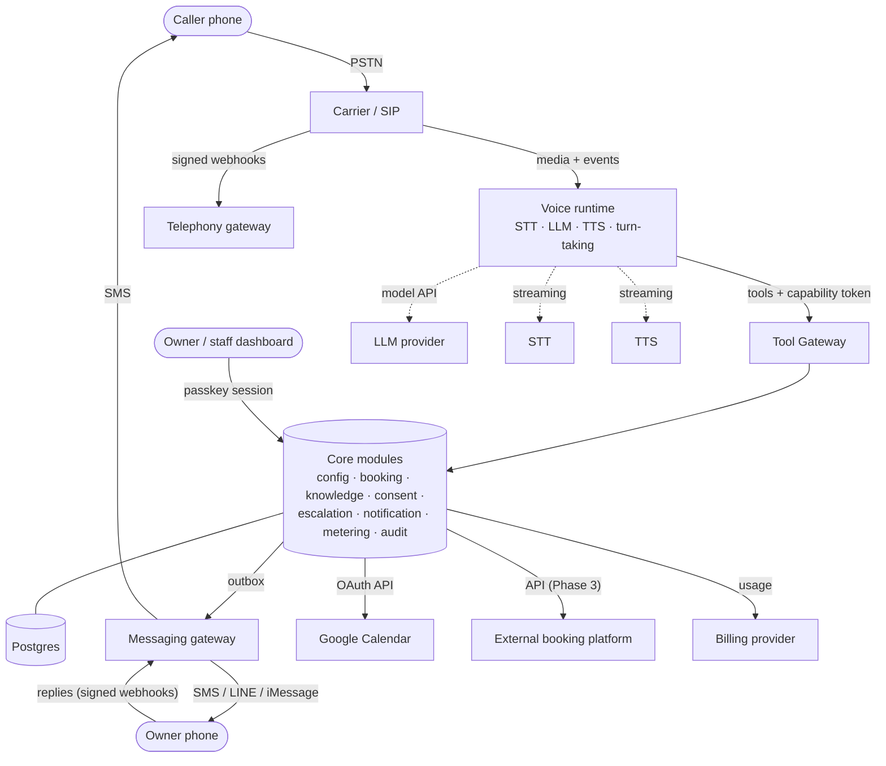
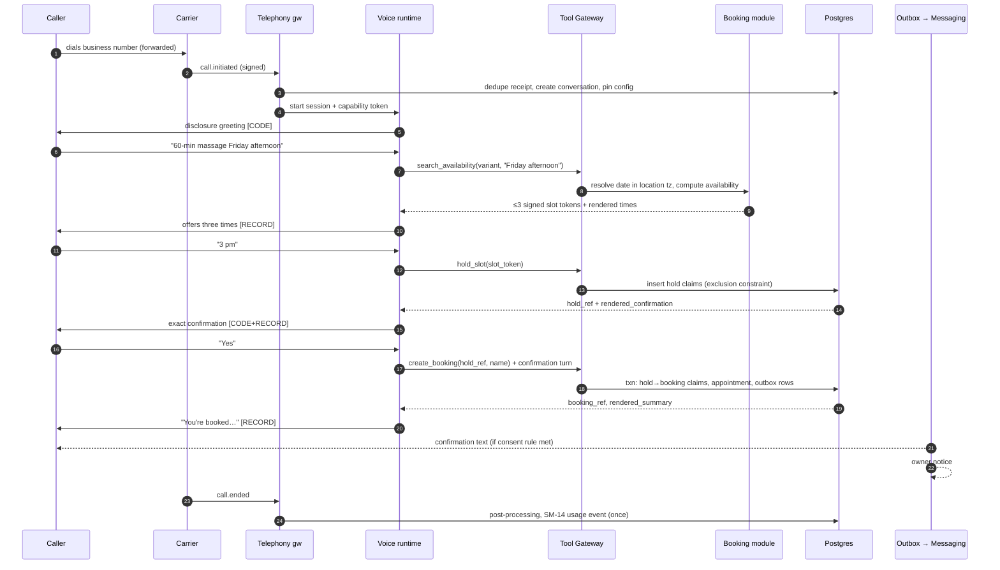
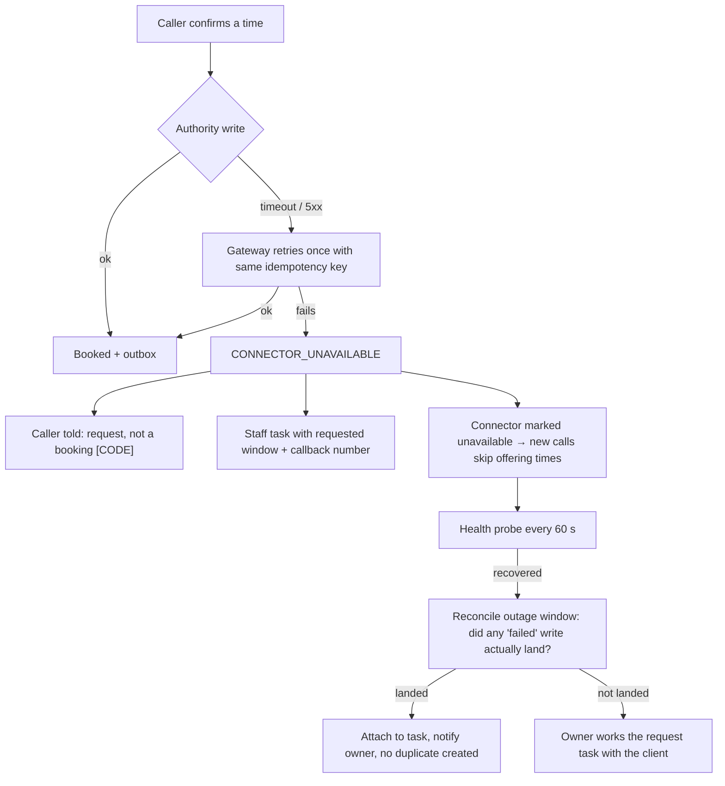
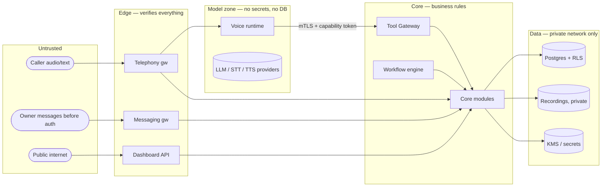

## 6. Architecture and trust boundaries

### 6.1 Shape [REC]

A **modular monolith** for the business logic (one deployable "core", one Postgres) plus a separately scaled
**voice runtime** and a small **messaging gateway** at the edge. Reason: a team of O2's size can operate one
database and one core service well; the voice runtime has different scaling and latency needs (long-lived audio
streams, colocated with the carrier and speech providers) and a different trust level (it talks to the model).
Module boundaries below are enforced in code (separate packages, no cross-module table access) so any module can be
split out later without a data migration.

### 6.2 Service boundaries

| # | Boundary | Owns (tables) | Responsibilities | Talks to |
|---|---|---|---|---|
| 1 | Identity & tenant | tenants, locations, users, memberships, owner_identities | Sign-in (passkey/OTP), roles, eligibility (SM-1), owner channel enrolment | all (auth context) |
| 2 | Configuration & versioning | configuration_versions, services, service_variants, resources, hours, policies | Draft → publish immutable versions; tool allow-lists; prompt templates; rollback = republish previous | runtime (read pinned version), booking |
| 3 | Telephony gateway | phone_numbers, routing_rules, conversations (voice rows), handoffs | Carrier webhooks, number → tenant, mint capability token, screened transfer legs, recording control | carrier, voice runtime, core |
| 4 | Messaging gateway | inbound_messages, message_deliveries, webhook_receipts (messaging), opt_outs | SMS/LINE/WhatsApp/iMessage ingress+egress, signature checks, STOP/START/HELP parser, delivery receipts, quiet hours, sender registration state | providers, consent, PQ, notification |
| 5 | Conversation orchestration (voice runtime) | none (stateless; writes via tools) | Audio streaming, turn-taking, STT/LLM/TTS, state-gated tool exposure, grounding and offer checks, latency watchdog, degraded path | Tool Gateway only |
| 6 | Tool Gateway (part of core) | tool_calls, idempotency_keys | Verify capability token, bind envelope, validate schema, dispatch to modules, typed errors | modules 2, 7–11 |
| 7 | Knowledge & retrieval | knowledge_articles, knowledge_candidates | Tenant-filtered retrieval, provenance, KC approval workflow, review dates | config, PQ |
| 8 | Client profile & consent | clients, client_identities, consents | Identity matching (ANI), consent evidence, purpose-scoped checks | messaging, booking, PQ |
| 9 | Booking & availability | appointments, slot_claims, appointment_events | Availability maths, holds, CAS writes, sagas, request-fallback tasks | connectors, outbox |
| 10 | External connectors | external_mappings, calendar_connections, sync_cursors | Google Calendar busy/mirror, external booking platform (Phase 3), OAuth token custody (KMS), reconciliation | providers, booking |
| 11 | Escalation (pending questions) | pending_questions, owner_replies | UQ creation (T-10), PQ machine, owner reply auth/validation, relay, late path | messaging, knowledge, notification |
| 12 | Notification | outbox_events, dead_letters | Templates, outbox dispatcher, retries, owner digests | messaging |
| 13 | Event/audit | audit_events (hash-chained), webhook_receipts | Append-only audit, receipt dedupe, evidence exports | all |
| 14 | Metering & billing | usage_events, provider_cost_events, invoices, adjustments | Billable classification (SM-14), cost capture, billing-provider sync, disputes | billing provider |
| 15 | Review & observability | (traces/logs store) | Per-turn latency traces, quality sampling, redaction, dashboards, alerts | all |
| 16 | Privacy & retention | retention_jobs, privacy_requests | SM-12, SM-13, provider purges, legal holds | all, providers |

### 6.3 The call capability token

Minted by the telephony gateway when the tenant is resolved (SM-2 `config_loading`): a signed token (Ed25519,
15-minute life, renewable while the call is live) with claims `{tenant_id, location_id, conversation_id,
config_version, allowed_tool_set_id, ani_hash, jurisdiction, exp, jti}`. The voice runtime attaches it to every
tool request; it is never placed in the model's context. The Tool Gateway rejects tokens for ended conversations.
The runtime's own credentials (to the Tool Gateway) are a separate mTLS identity, so a stolen token alone is not
enough.

### 6.4 Context diagram



*Plain language:* the caller's audio goes to the voice runtime, which can only *ask* the core to do things through
the Tool Gateway. Everything that changes data — bookings, consent, pending questions, messages — lives in the core
and its database. Messages to the owner and the caller leave through one messaging gateway, which is also where
replies and STOP words come in.

### 6.5 Sequence: inbound call to confirmed booking



*Plain language:* the AI never invents a time: it offers signed options from the booking module, holds the chosen
one in the database (which physically refuses overlaps), reads back a sentence built from that hold, and only then
writes the booking — together with the messages that announce it.

### 6.6 Sequence: owner escalation (unknown question)

```mermaid
sequenceDiagram
  autonumber
  participant C as Caller
  participant V as Voice runtime
  participant G as Tool Gateway
  participant E as Escalation module
  participant W as Workflow timers
  participant M as Messaging gateway
  participant O as Owner
  C->>V: question with no approved answer
  V->>C: "I don't have a confirmed answer… I won't guess" [CODE]
  V->>G: safety gate (rules + classifier)
  G-->>V: tier N, transfer ineligible now
  V->>C: offer text follow-up; confirm question, number, permission
  V->>G: record_consent → request_owner_answer
  G->>E: txn: pending_question + outbox (+ timers)
  E->>W: schedule reminders + expiry
  V->>C: "We'll text you when they reply… anything else?" [CODE]
  Note over C,V: call continues or ends — no hold
  E->>M: owner message (minimum context, handle, actions)
  M->>O: LINE / SMS
  O->>M: reply (quoted / handle)
  M->>E: signed webhook → authenticate + match + validate
  E->>O: preview of exact text — Send?
  O->>E: Send
  E->>M: answer text (consent + opt-out checked)
  M->>C: SMS with owner's exact words
  M->>E: delivered
  E->>O: receipt, then separate "save for future callers?"
  W-->>E: (if no reply) expiry → truthful text to caller
```

*Plain language:* the caller is told the truth and set free; the question travels to the owner with only what the
owner needs; the owner's answer is checked before it goes back; and saving it as a reusable answer is a separate,
deliberate tap.

### 6.7 Failure and recovery: external booking outage



*Plain language:* if the booking system goes down, the AI stops promising times and takes requests instead; when
it comes back, a reconciliation pass checks whether any write that looked failed actually succeeded, so nothing is
booked twice and nothing is silently lost.

### 6.8 Deployment and trust boundaries



| Zone | Trust | Holds | Can reach |
|---|---|---|---|
| Z0 | None | — | Edge only |
| Z1 Edge | Verifies signatures, sessions, rate limits | Provider webhook secrets | Core |
| Z2 Model zone | Low — processes untrusted speech; may be manipulated | Provider API keys for STT/LLM/TTS only; capability token per call | Tool Gateway, model providers; **no** DB, **no** messaging, **no** calendar |
| Z3 Core | High | Business logic; decrypts OAuth tokens via KMS just-in-time | Data zone, connectors, messaging gw |
| Z4 Data | Highest | Data at rest (region per D-06) | Nothing outbound |

### 6.9 Latency budget (voice turn) [REC, to be measured at Gate A/B]

| Segment | Target p50 | Notes |
|---|---|---|
| End-of-speech detection | 200–350 ms | Endpointing tuned per language; Thai may need longer |
| STT final | 100–250 ms | Streaming; partials used for early intent |
| LLM first token | 300–600 ms | Prompt cached; short tool list per state |
| Tool call (when needed) | 100–400 ms | Core colocated with DB; filler line if > 700 ms predicted |
| TTS first audio | 100–250 ms | Streaming |
| Network (runtime ↔ providers) | 50–150 ms | Region choice D-06 matters most for Thailand |
| **Total to first audio** | **≤ 1.0 s p50, ≤ 1.8 s p95** | Watchdog at 1.8 s (filler) and 4 s (degraded) |
